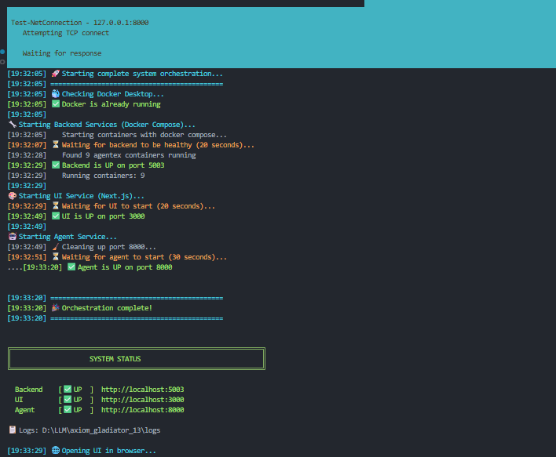
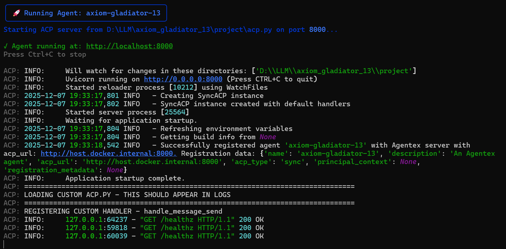
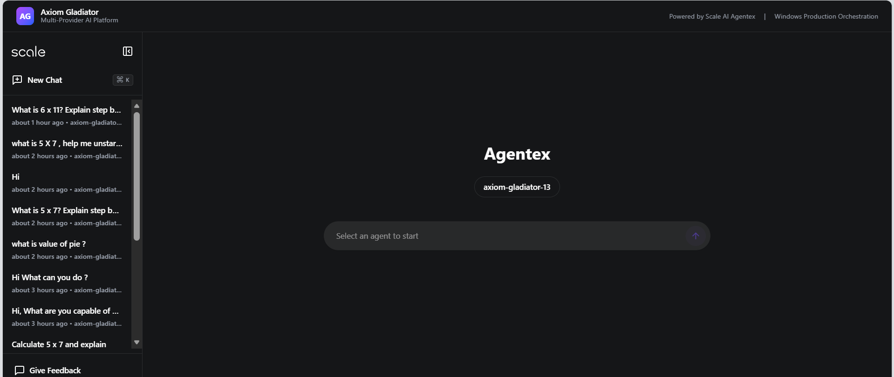
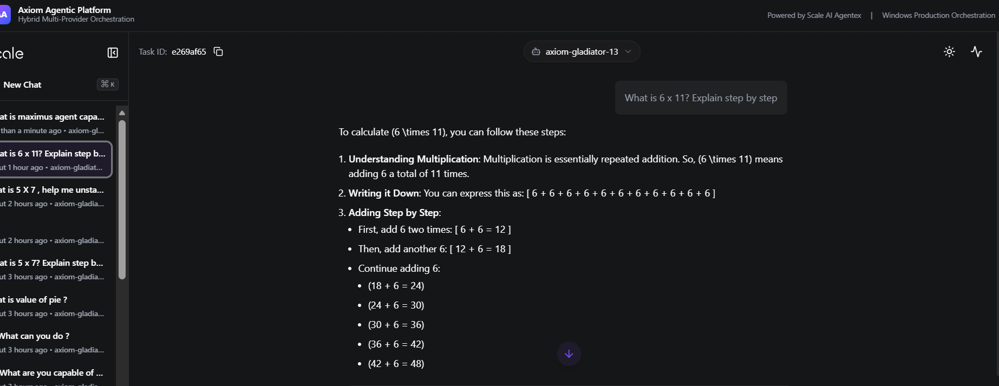

# Axiom Agentic Platform

**Hybrid Multi-Provider AI Agent Orchestration for Windows with Cloud Flexibility**

An enterprise-ready agentic platform built as a Windows-native extension to Scale AI's Agentex framework, enabling seamless multi-provider AI integration (OpenAI, AWS Bedrock, Anthropic) with production-grade Docker orchestration and real-time streaming capabilities.

---

## 🎯 Project Vision

**Axiom Agentic Platform** transforms Scale AI's Linux-focused Agentex framework into a production-ready Windows solution with:

- **Windows-Native Orchestration**: PowerShell-based automation with Docker Desktop stability management
- **Multi-Provider Flexibility**: OpenAI, AWS Bedrock, Anthropic Claude integration
- **Cloud-Ready Architecture**: Containerized backend with horizontal scalability
- **Production Reliability**: 60-second cold start, automated health checks, comprehensive error handling
- **Enterprise Documentation**: Complete setup guides, troubleshooting playbooks, testing cheatsheets

---

## 🏆 Built On Scale AI Agentex

This platform extends **[Scale AI's Agentex](https://github.com/scaleapi/scale-agentex)** framework with Windows-specific enhancements:

**Scale AI Agentex Provides:**
- Multi-agent orchestration infrastructure
- Real-time message streaming protocol
- Docker-based microservices backend (PostgreSQL, Redis, FastAPI)
- Next.js UI with React components

**Axiom Gladiator Adds:**
- ⭐ Windows PowerShell orchestration layer (ORCHESTRATOR_MASTER.ps1)
- ⭐ Docker Desktop stability management (process cleanup, daemon verification)
- ⭐ Multi-provider AI integration (OpenAI GPT-4, AWS Bedrock ready)
- ⭐ Custom agent communication protocol handlers
- ⭐ React SSR/CSR hydration fixes for production deployment
- ⭐ Comprehensive Windows deployment automation

---

## 🚀 Quick Start

### Prerequisites
- Windows 10/11 with PowerShell 5.1+
- Docker Desktop 4.x+
- Python 3.10+ (with UV package manager)
- Node.js 18+ (for UI)
- Git

### Installation

```powershell
# Clone repository
git clone https://github.com/Shreyasg13/axiom-agentic-platform.git
cd axiom-agentic-platform

# Run master orchestrator (handles everything)
.\orchestration\ORCHESTRATOR_MASTER.ps1
```

**What happens:**
1. ✅ Docker Desktop verification & stability checks (60s)
2. ✅ Backend services start (9 containers: PostgreSQL, Redis, FastAPI) (20s)
3. ✅ UI starts with custom branding (Next.js dev server) (20s)
4. ✅ Agent registers with OpenAI integration (30s)
5. 🌐 Browser opens to `http://localhost:3000`

**Total Time**: ~2 minutes cold start, 40 seconds warm restart

---

## 📸 Screenshots

See the platform in action: **[Screenshots Gallery](screenshots/)**

<p align="center">
  
  
</p>

<p align="center">
  
  
</p>

*Add your screenshots to the `screenshots/` folder - see [Screenshot Guide](screenshots/README.md)*

---

## 📁 Project Structure

```
axiom-agentic-platform/
├── orchestration/          # Windows automation layer
│   ├── ORCHESTRATOR_MASTER.ps1    # Primary controller
│   ├── QUICK_RESTART.ps1          # Fast restart helper
│   ├── CHECK_STATUS.ps1           # Health checker
│   └── START_AGENT_STANDALONE.ps1 # Agent-only starter
│
├── agent/                  # Agent implementation
│   ├── manifest.yaml              # Agent configuration
│   ├── acp.py                     # Custom message handler
│   └── start_agent_standalone.py  # Python agent wrapper
│
├── docs/                   # Comprehensive documentation
│   ├── ARCHITECTURE.md
│   ├── HOW_TO_USE.md
│   ├── TESTING_GUIDE.md
│   └── TROUBLESHOOTING.md
│
└── README.md              # This file
```

---

## 🎨 Features

### Windows Production Orchestration
- **Master Controller**: Single entry point (`ORCHESTRATOR_MASTER.ps1`)
- **Docker Stability**: Process cleanup, extended waits, daemon verification
- **Service Management**: Automated startup sequencing with health checks
- **Error Recovery**: Retry loops, fallback strategies, detailed logging

### Multi-Provider AI Integration
- **OpenAI**: GPT-4, GPT-4o-mini with streaming responses
- **AWS Bedrock**: Claude 3, Titan models (configuration ready)
- **Custom Handlers**: Pluggable message processing architecture

### Enterprise Features
- **Real-time Streaming**: WebSocket-based message delivery
- **Containerized Backend**: Docker Compose orchestration
- **Horizontal Scaling**: Microservices architecture
- **Health Monitoring**: Port checks, API verification, container status

---

## 🛠️ Technical Stack

**Backend:**
- Python 3.10+ (FastAPI, SQLAlchemy)
- PostgreSQL (agent state)
- Redis (message queue)
- Docker Compose (orchestration)

**Frontend:**
- Next.js 14 (React 18)
- TypeScript
- Tailwind CSS

**Windows Automation:**
- PowerShell 5.1+
- Docker Desktop API
- Process management

**AI Providers:**
- OpenAI API (GPT-4)
- AWS Bedrock (ready)
- Custom provider support

---

## 📚 Documentation

- **[Architecture Overview](docs/ARCHITECTURE.md)** - System design & components
- **[How to Use](docs/HOW_TO_USE.md)** - Detailed usage guide
- **[Testing Guide](docs/TESTING_GUIDE.md)** - Comprehensive testing scenarios
- **[Troubleshooting](docs/TROUBLESHOOTING.md)** - Common issues & solutions

---

## 🧪 Testing

```powershell
# Check system status
.\orchestration\CHECK_STATUS.ps1

# Quick restart (Docker already running)
.\orchestration\QUICK_RESTART.ps1

# Agent-only restart
.\orchestration\START_AGENT_STANDALONE.ps1
```

**Test AI Integration:**
1. Open `http://localhost:3000`
2. Select agent from dropdown
3. Send message: "What is 6 x 11? Explain step by step."
4. Verify OpenAI response with reasoning

---

## 🐛 Known Issues & Solutions

### Docker Desktop Daemon Instability
**Issue**: Daemon unresponsive after cold start  
**Solution**: Automated process cleanup + 60s initial wait + verification loops

### React Hydration Errors
**Issue**: SSR/CSR layout mismatch in Next.js UI  
**Solution**: Fixed flexbox layout structure (documented in patches/)

### Agent Registration Failures
**Issue**: `openai-agents` module not found  
**Solution**: Install via UV tools Python (automated in orchestrator)

---

## 📄 License

**MIT License** - See [LICENSE](LICENSE) file

### Attribution
Built as an extension to **Scale AI Agentex** (Apache 2.0 License)  
Original framework: https://github.com/scaleapi/scale-agentex

Copyright (c) Scale AI, Inc.

---

## 🤝 Contributing

Contributions welcome! Please read [CONTRIBUTING.md](CONTRIBUTING.md) for guidelines.

**Areas for Enhancement:**
- AWS Bedrock integration completion
- Anthropic Claude direct integration
- Azure OpenAI support
- Linux/macOS orchestration scripts
- Kubernetes deployment configs

---

## 👨‍💻 Author

**Your Name**  
Production Windows orchestration & multi-provider AI integration

**Built on Scale AI's Agentex framework**  
https://github.com/scaleapi/scale-agentex

---

## 📞 Support

- **Issues**: [GitHub Issues](https://github.com/Shreyasg13/axiom-agentic-platform/issues)
- **Discussions**: [GitHub Discussions](https://github.com/Shreyasg13/axiom-agentic-platform/discussions)
- **Scale AI Agentex**: [Original Repo](https://github.com/scaleapi/scale-agentex)

---

## 🎯 Roadmap

**Phase 1 - Foundation** ✅
- [x] Windows PowerShell orchestration
- [x] Docker stability management
- [x] OpenAI integration
- [x] Production documentation

**Phase 2 - Multi-Provider** 🚧
- [ ] AWS Bedrock integration
- [ ] Anthropic Claude support
- [ ] Azure OpenAI integration
- [ ] Provider switching UI

**Phase 3 - Cloud Deployment** 📋
- [ ] AWS ECS deployment
- [ ] Azure Container Apps
- [ ] Kubernetes manifests
- [ ] CI/CD pipelines

**Phase 4 - Enterprise Features** 📋
- [ ] Multi-agent collaboration
- [ ] Agent marketplace
- [ ] Usage analytics
- [ ] Role-based access control

---

**Star ⭐ this repo if it helps you build production AI agents on Windows!**
